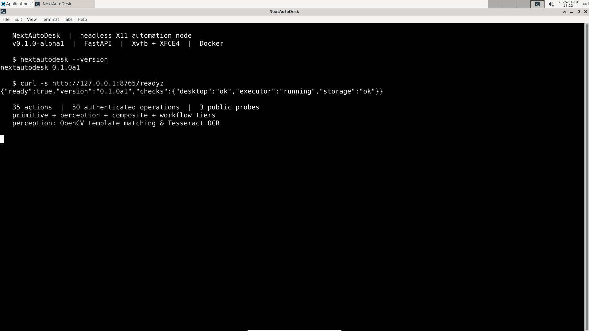

# NextAutoDesk

**Headless X11/XFCE GUI automation node, exposed over HTTP.**

Run a real Linux desktop in a container and drive it through one API: mouse and
keyboard input, screenshots, windows, element perception, composed interactions
and queued multi-step tasks. The desktop has no monitor attached — Xvfb + XFCE
provide a full X11 session that automation clients control remotely.

**v0.1.0-alpha1** · Python 3.12 · Ubuntu 24.04 · Xvfb + XFCE · FastAPI · OpenCV + Tesseract

[English](README.md) · [简体中文](README.zh-CN.md)



## What you can do

The API is organized in four tiers. Every tier is discoverable at runtime
(`GET /api/v1/actions` → `tiers`, `GET /api/v1/info` → `perception`).

| Tier | Namespace | Examples |
| --- | --- | --- |
| **primitive** | `/mouse`, `/keyboard`, `/screen`, `/windows`, `/desktop` | Move/click/drag/scroll, type Unicode text, hotkeys, capture screenshots, list/focus/move windows |
| **perception** | `/elements` | Find elements by template image (OpenCV) or by text/OCR (Tesseract), wait for them to appear, OCR a region |
| **composite** | `/interactions` | Click a found element, type into a found field — locate + act in one call |
| **workflow** | `/tasks` | Queue multi-step tasks, poll status, cancel, survive restarts via SQLite persistence |

## Why NextAutoDesk

- **Human-like input by default.** Pointer and keyboard behaviour defaults to
  [human-movement](https://pypi.org/project/human-movement/), a research-backed
  open-source engine (real input data, Fitts' law, minimum-jerk trajectories,
  rhythm models) — not an in-house approximation.
- **Element perception without hand-rolled CV.** Template matching uses OpenCV;
  text recognition uses the Tesseract OCR engine. No reinvented image-processing
  algorithms.
- **Per-operation strategy configuration.** All 19 mouse/keyboard operations have
  independent providers and parameters, switchable by config or per request
  without code changes.
- **One serial writer.** A single FIFO worker executes every mutating action and
  task, so concurrent clients can never interleave pointer/keyboard input.
  Read-only queries and perception bypass the queue.
- **Dockerized Linux desktop.** One container owns Xvfb, XFCE, the API and a
  persistent `/data` volume. VNC stays disabled by default; the API is the only
  access path.

## Quick start

### Build and run the image

```bash
# from the repository root; the tag is derived from the package version
./scripts/build-image.sh

# one-off run (data lives in ./data and must be writable by uid 1000)
mkdir -p data && sudo chown -R 1000:1000 data
docker run -d --name nextautodesk -p 8765:8765 \
  -e NEXT_AUTODESK_API_KEYS="$(openssl rand -hex 32)" \
  -v "$PWD/data:/data" nextautodesk:0.1.0-alpha1
```

With Compose (recommended for deployments):

```bash
cp deploy/.env.example deploy/.env          # set NEXT_AUTODESK_API_KEYS
mkdir -p deploy/data deploy/config
cp config/nextautodesk.example.yml deploy/config/nextautodesk.yml
sudo chown -R 1000:1000 deploy/data
docker compose -f deploy/docker-compose.yml up -d
```

See [deployment.md](docs/deployment.md) for building on the deployment host,
image transfer, resource limits and operations.

### Call the API

```bash
KEY=<api-key>
BASE=http://<host>:8765/api/v1

# primitive: move the pointer
curl -s -X POST $BASE/mouse/move -H "X-API-Key: $KEY" \
  -H 'Content-Type: application/json' -d '{"x": 960, "y": 540}'

# perception: find an element by text
curl -s -X POST $BASE/elements/find -H "X-API-Key: $KEY" \
  -H 'Content-Type: application/json' \
  -d '{"query": {"text": {"text": "Sign in"}}}'

# perception: find an element by template (base64 or a saved screenshot name)
curl -s -X POST $BASE/elements/find -H "X-API-Key: $KEY" \
  -H 'Content-Type: application/json' \
  -d '{"query": {"template": {"screenshot": "login-button.png"}}}'

# perception: OCR a region
curl -s -X POST $BASE/elements/ocr -H "X-API-Key: $KEY" \
  -H 'Content-Type: application/json' \
  -d '{"region": {"x": 0, "y": 0, "width": 960, "height": 540}, "languages": ["eng"]}'

# composite: click the element
curl -s -X POST $BASE/interactions/click -H "X-API-Key: $KEY" \
  -H 'Content-Type: application/json' \
  -d '{"query": {"text": {"text": "Sign in"}}, "wait_timeout_ms": 5000}'

# workflow: queue a task
curl -s -X POST $BASE/tasks -H "X-API-Key: $KEY" \
  -H 'Content-Type: application/json' -d '{
    "name": "demo",
    "steps": [
      {"action": "interaction.click", "params": {"query": {"text": {"text": "Sign in"}}}},
      {"action": "keyboard.type", "params": {"text": "hello"}},
      {"action": "screen.screenshot", "params": {"save": true}}
    ]
  }'
```

A successful action returns an `ActionResult`; perception returns matches with
**absolute screen coordinates**, ready to click. Full request/response schemas
and every endpoint are documented in [docs/api.md](docs/api.md).

## Documentation

| Document | Contents |
| --- | --- |
| [docs/architecture.md](docs/architecture.md) | Layers, API tiers, contracts, directories, design decisions |
| [docs/api.md](docs/api.md) | Complete HTTP API reference, error codes and examples |
| [docs/perception.md](docs/perception.md) | Element model, template/OCR locators, tuning, limitations |
| [docs/strategies.md](docs/strategies.md) | Providers, per-operation configuration, extending |
| [docs/deployment.md](docs/deployment.md) | Docker build/deploy, verification, operations, resource limits |
| [docs/testing.md](docs/testing.md) | Unit/integration/CI and container smoke/E2E tests |
| [CONTRIBUTING.md](CONTRIBUTING.md) | Development setup, tests, lint, PR expectations |
| [THIRD_PARTY_NOTICES.md](THIRD_PARTY_NOTICES.md) | Third-party components and licences |

## Requirements

- **Linux/X11 only.** The node drives an X11 desktop; the supported runtime is
  the provided Linux `amd64` Docker image (Xvfb + XFCE inside the container).
  macOS and Windows are not supported.
- Docker Engine with Compose v2 on the deployment host.
- Python 3.12 for running from source. The API itself can be called from any OS
  and language over HTTP.

## Security

API keys are required for every `/api/v1` endpoint (health probes are public).
The container runs as a non-root user with `cap_drop: ALL`,
`no-new-privileges`, resource limits and no host devices. Never expose the
unauthenticated VNC overlay publicly; the default image does not install VNC.

## License

MIT. The runtime image bundles third-party open-source components; the project
`LICENSE` and the full attribution notice are included in the image under
`/app/licenses/`. Third-party components and their licences are listed in
[THIRD_PARTY_NOTICES.md](THIRD_PARTY_NOTICES.md).
