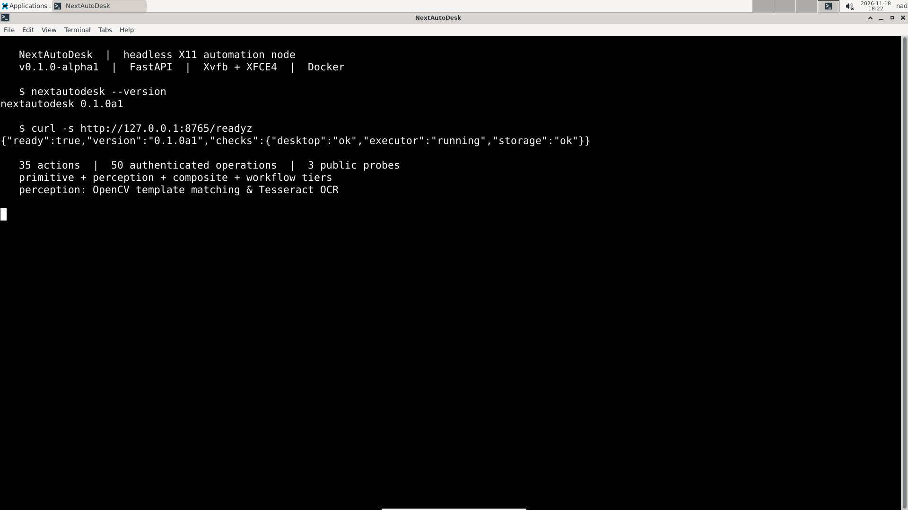

# NextAutoDesk

**无头 X11/XFCE GUI 自动化节点，通过 HTTP 对外提供服务。**

在容器中运行一套真实的 Linux 桌面，并通过同一个 API 驱动它：鼠标与键盘输入、
截图、窗口管理、元素感知、组合交互，以及排队执行的多步骤任务。桌面没有物理显示器——
Xvfb + XFCE 提供完整的 X11 会话，自动化客户端可远程控制。

**v0.1.0-alpha1** · Python 3.12 · Ubuntu 24.04 · Xvfb + XFCE · FastAPI · OpenCV + Tesseract

[English](README.md) · [简体中文](README.zh-CN.md)



## 能做什么

API 分为四个层级，运行时可自动发现（`GET /api/v1/actions` 的 `tiers`、
`GET /api/v1/info` 的 `perception`）。

| 层级 | 命名空间 | 示例 |
| --- | --- | --- |
| **primitive（原语）** | `/mouse`、`/keyboard`、`/screen`、`/windows`、`/desktop` | 移动/点击/拖拽/滚动、输入 Unicode 文本、组合键、截图、列出/聚焦/移动窗口 |
| **perception（感知）** | `/elements` | 按模板图片（OpenCV）或按文字/OCR（Tesseract）查找元素、等待元素出现、识别屏幕区域文字 |
| **composite（组合）** | `/interactions` | 点击找到的元素、向找到的输入框输入文字——一次调用完成“定位 + 操作” |
| **workflow（工作流）** | `/tasks` | 提交多步骤任务、轮询状态、取消任务，SQLite 持久化支持重启恢复 |

## 为什么选择 NextAutoDesk

- **默认拟人输入。** 指针与键盘行为默认使用
  [human-movement](https://pypi.org/project/human-movement/)：一个基于真实输入数据、
  Fitts 定律、最小加加速度轨迹与节奏模型的开源引擎，而不是自研的近似算法。
- **元素感知基于成熟视觉库。** 模板匹配使用 OpenCV，文字识别使用 Tesseract OCR 引擎，
  不自行发明图像处理算法。
- **每个操作独立策略。** 19 个鼠标/键盘操作各自拥有独立的 provider 与参数，
  可通过配置或单次请求切换，无需改代码。
- **单一串行写入者。** 所有会改变桌面状态的动作与任务都由一个 FIFO 单 worker 执行，
  并发客户端不会交错鼠标/键盘输入；只读查询和感知请求绕过队列。
- **Docker 化的 Linux 桌面。** 一个容器包含 Xvfb、XFCE、API 与持久化 `/data` 卷。
  默认不启用 VNC，API 是唯一访问入口。

## 快速开始

### 构建并运行镜像

```bash
# 在仓库根目录执行；镜像 tag 由包版本推导
./scripts/build-image.sh

# 一次性运行（数据在 ./data，需由 uid 1000 用户可写）
mkdir -p data && sudo chown -R 1000:1000 data
docker run -d --name nextautodesk -p 8765:8765 \
  -e NEXT_AUTODESK_API_KEYS="$(openssl rand -hex 32)" \
  -v "$PWD/data:/data" nextautodesk:0.1.0-alpha1
```

使用 Compose（推荐用于正式部署）：

```bash
cp deploy/.env.example deploy/.env          # 设置 NEXT_AUTODESK_API_KEYS
mkdir -p deploy/data deploy/config
cp config/nextautodesk.example.yml deploy/config/nextautodesk.yml
sudo chown -R 1000:1000 deploy/data
docker compose -f deploy/docker-compose.yml up -d
```

在部署主机上构建、镜像传输、资源限制与日常运维见
[部署文档](docs/deployment.md)。

### 调用 API

```bash
KEY=<api-key>
BASE=http://<host>:8765/api/v1

# 原语层：移动指针
curl -s -X POST $BASE/mouse/move -H "X-API-Key: $KEY" \
  -H 'Content-Type: application/json' -d '{"x": 960, "y": 540}'

# 感知层：按文字查找元素
curl -s -X POST $BASE/elements/find -H "X-API-Key: $KEY" \
  -H 'Content-Type: application/json' \
  -d '{"query": {"text": {"text": "Sign in"}}}'

# 感知层：按模板查找元素（base64，或已保存截图的名称）
curl -s -X POST $BASE/elements/find -H "X-API-Key: $KEY" \
  -H 'Content-Type: application/json' \
  -d '{"query": {"template": {"screenshot": "login-button.png"}}}'

# 感知层：识别区域文字
curl -s -X POST $BASE/elements/ocr -H "X-API-Key: $KEY" \
  -H 'Content-Type: application/json' \
  -d '{"region": {"x": 0, "y": 0, "width": 960, "height": 540}, "languages": ["eng"]}'

# 组合层：点击该元素
curl -s -X POST $BASE/interactions/click -H "X-API-Key: $KEY" \
  -H 'Content-Type: application/json' \
  -d '{"query": {"text": {"text": "Sign in"}}, "wait_timeout_ms": 5000}'

# 工作流层：提交任务
curl -s -X POST $BASE/tasks -H "X-API-Key: $KEY" \
  -H 'Content-Type: application/json' -d '{
    "name": "demo",
    "steps": [
      {"action": "interaction.click", "params": {"query": {"text": {"text": "Sign in"}}}},
      {"action": "keyboard.type", "params": {"text": "hello"}},
      {"action": "screen.screenshot", "params": {"save": true}}
    ]
  }'
```

动作请求成功时返回 `ActionResult`；感知结果中的坐标是**屏幕绝对坐标**，可直接点击。
完整请求/响应结构与全部端点见 [API 文档](docs/api.md)。

## 文档

| 文档 | 内容 |
| --- | --- |
| [docs/architecture.md](docs/architecture.md) | 分层架构、API 层级、契约、目录职责、设计决策 |
| [docs/api.md](docs/api.md) | 完整 HTTP API 参考、错误码与示例 |
| [docs/perception.md](docs/perception.md) | 元素模型、模板/OCR 定位器、调参与限制 |
| [docs/strategies.md](docs/strategies.md) | Provider、按操作配置、扩展方式 |
| [docs/deployment.md](docs/deployment.md) | Docker 构建/部署、验证、运维、资源限制 |
| [docs/testing.md](docs/testing.md) | 单元/集成/CI 与容器冒烟/E2E 测试 |
| [CONTRIBUTING.md](CONTRIBUTING.md) | 开发环境、测试、代码检查与 PR 要求 |
| [THIRD_PARTY_NOTICES.md](THIRD_PARTY_NOTICES.md) | 第三方组件与许可证 |

## 环境要求

- **仅支持 Linux/X11。** 节点驱动的是 X11 桌面，受支持的运行形态是仓库提供的
  Linux `amd64` Docker 镜像（容器内运行 Xvfb + XFCE）；不支持 macOS 与 Windows。
- 部署主机需要 Docker Engine 与 Compose v2。
- 从源码运行需要 Python 3.12。API 本身可由任意操作系统、任意语言通过 HTTP 调用。

## 安全

所有 `/api/v1` 端点都要求 API Key（健康探针公开）。容器以非 root 用户运行，
配置了 `cap_drop: ALL`、`no-new-privileges`、资源限制，且不挂载宿主机设备。
切勿将无认证的 VNC overlay 暴露到公网；默认镜像不安装 VNC。

## 许可证

MIT。运行时镜像中打包了第三方开源组件；项目 `LICENSE` 与完整第三方声明随镜像位于
`/app/licenses/`。第三方组件及其许可证见
[THIRD_PARTY_NOTICES.md](THIRD_PARTY_NOTICES.md)。
